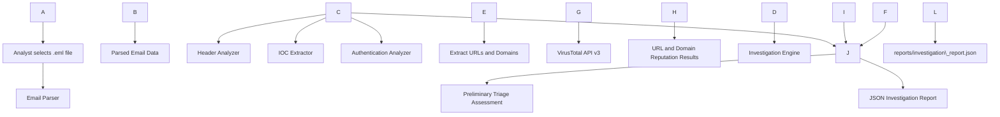

PhishTrace System Architecture

Architecture Diagram

Component Descriptions

1.Email Parser: Reads the `.eml` file and extracts email headers and content.

2.Header Analyzer: Identifies potentially suspicious header characteristics.

3.IOC Extractor: Extracts URLs and domains from the email body.

4.Authentication Analyzer: Assesses SPF, DKIM, and DMARC evidence present in the supplied headers.

5.VirusTotal Integration: Queries existing URL and domain reputation records.

6.Investigation Engine: Combines analysis results into a preliminary assessment.

7.JSON Report Generator: Saves the consolidated findings for analyst review.

Data Flow

The analyst provides an email file. PhishTrace parses it and runs header, indicator, and authentication analysis. Extracted URLs and domains are checked against existing VirusTotal records when the API key is configured. The investigation engine combines the results and saves a JSON report.

Security Considerations

\->PhishTrace does not intentionally visit extracted URLs.

\->The VirusTotal module queries existing reports rather than uploading email files.

\->An `UNKNOWN` reputation result does not mean an indicator is safe or malicious.

\->Authentication findings are based on supplied headers and are not independently verified.

\->Only synthetic or non-sensitive samples should be used during project testing.

